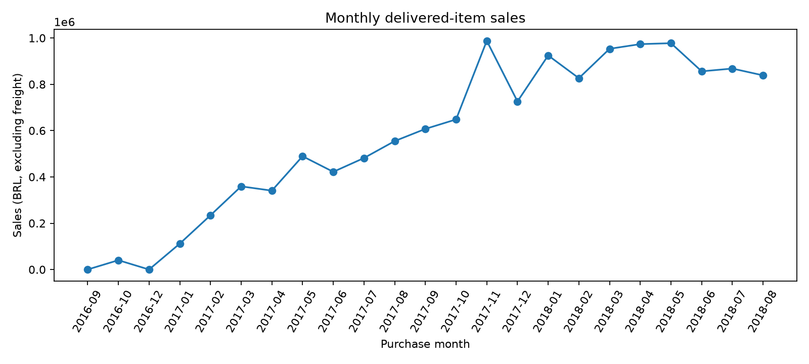
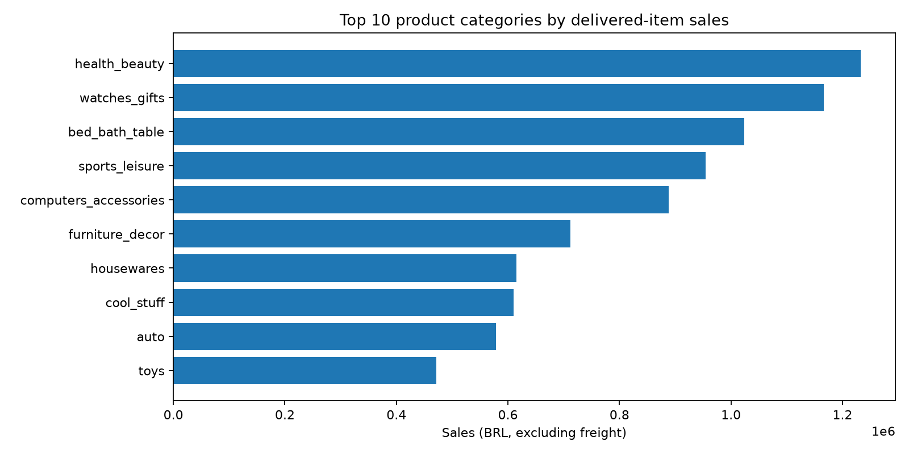
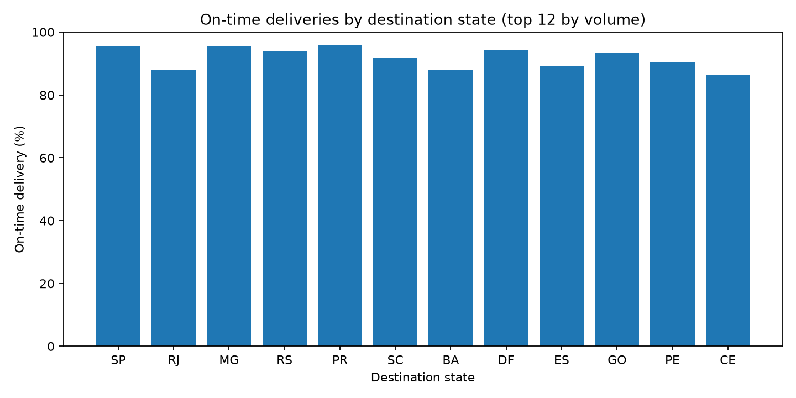
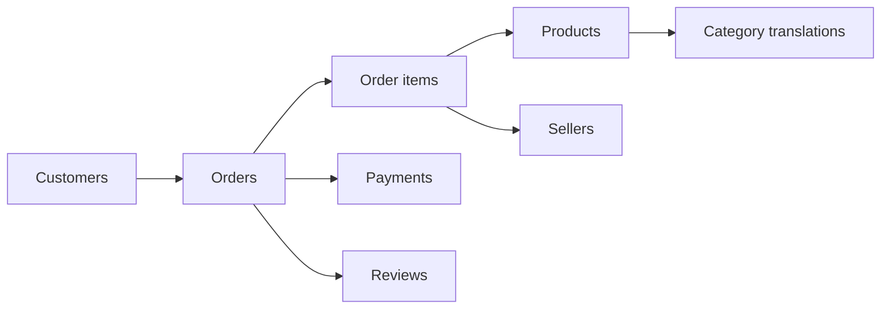

# E-commerce Analytics | SQL & Python Portfolio

**An end-to-end data analytics portfolio project using real historical e-commerce transactions.**

**Stack:** SQLite · SQL (CTEs, joins, aggregations, window functions) · Python · Matplotlib · Data quality checks

## Business problem

Imagine joining an e-commerce analytics team. Stakeholders want to understand sales performance, customer behavior and delivery quality using data rather than assumptions. This project answers ten business questions with **reproducible SQL queries** and turns the findings into tables and charts.

## Data source and attribution

[**Brazilian E-Commerce Public Dataset by Olist** (Kaggle)](https://www.kaggle.com/datasets/olistbr/brazilian-ecommerce), published by Olist and collaborators. The historical anonymized dataset contains approximately **100,000 orders placed between 2016 and 2018** across multiple Brazilian marketplaces. Olist distributes it under **CC BY-NC-SA 4.0**. The original CSV files are *not included here*; download them from the publisher and observe its license terms.

> **Project status: COMPLETE — verified real-data analysis.** GitHub Actions downloaded eight original CSVs from [Olist's public GitHub repository](https://github.com/olist/work-at-olist-data/tree/master/datasets), loaded them into SQLite, ran the SQL queries and published the resulting tables and charts. [View successful workflow](https://github.com/ismaelberja/olist-ecommerce-sql-portfolio/actions/runs/41481473572).

## Results from real Olist transactions

The following metrics were **computed using original Olist data**, not synthetic test fixtures. All sales are delivered-order **item prices, excluding freight**, denominated in **Brazilian reais (BRL)**.

| Metric | Computed result |
|---|---:|
| Delivered orders | **96,478** |
| Unique buyers with delivered orders | **93,358** |
| Delivered item sales (excl. freight) | **R$ 13,221,498.11** |
| Average delivered-order value | **R$ 137.04** |
| On-time delivery rate (non-missing dates) | **93.23%** |
| Repeat buyers (2+ delivered orders) | **2,801** |

**Insights for stakeholders:**

1. **Category concentration:** Health & beauty (R$ 1.23m), watches & gifts (R$ 1.17m) and bed, bath & table (R$ 1.02m) are the top three categories by delivered item sales, contributing approximately **25.9%** of total item sales. Consider monitoring their volume and delivery performance.
2. **Customer retention:** 2,801 out of 93,358 buyers in the delivered-order sample placed more than one delivered order (approximately **3.0%**). This is an observation within a historical, limited window—not an overall lifetime retention rate.
3. **Regional delivery gap:** In the measured delivered orders, São Paulo (SP) had **95.51%** on-time deliveries, compared with **87.89%** for Rio de Janeiro (RJ). A region-by-region logistics review could examine the differences before making operational changes.
4. **Delivery and satisfaction:** Orders delivered late had an average review score of **2.27**, compared with **4.29** for on-time deliveries. This is a descriptive association and **does not demonstrate causation**.

[Browse all 10 calculated SQL results and data quality reports](reports/published/) · [Read definitions and limitations](docs/metrics.md)

### Charts

**Historical monthly delivered-item sales**



**Top product categories by delivered-item sales**



**On-time delivery by destination state**




## Verified results from the real Olist dataset

The pipeline ran on Olist's original public records (2016–2018). Figures below come from [the generated report](reports/published/SUMMARY.md), not from synthetic tests.

| Metric | Verified result |
|---|---:|
| Delivered orders with items | **96,478** |
| Unique buyers of delivered orders | **93,358** |
| Gross delivered-item sales (excluding freight) | **BRL 13,221,498.11** |
| Average order value (item prices only) | **BRL 137.04** |
| Shipping charged on delivered orders | **BRL 2,202,965.54** |
| Deliveries on or before the estimated date | **93.23%** |

These are descriptive results from a historical marketplace dataset, not the company's current results. Gross item sales are **not** profit or recognized net revenue. Source definitions and denominator rules are documented in [docs/metrics.md](docs/metrics.md).

### Data visualizations

| Monthly sales | Top product categories |
|---|---|
|  |  |


Explore the [10 exported query result tables](reports/published/) and [data-quality checks](reports/published/quality_checks.json). The full-data audit found **zero foreign-key violations**. Time coverage and incomplete boundary months should be considered before drawing conclusions.

## Questions answered

| # | Business question | SQL |
|---|---|---|
| 01 | What are delivered-order sales, AOV and on-time delivery? | [Executive KPIs](sql/queries/01_executive_kpis.sql) |
| 02 | How does monthly sales performance change over time? | [Monthly sales](sql/queries/02_monthly_sales.sql) |
| 03 | Which product categories generate the most sales? | [Category performance](sql/queries/03_category_performance.sql) |
| 04 | How important are repeat customers? | [Repeat customers](sql/queries/04_repeat_customers.sql) |
| 05 | How does delivery reliability vary by state? | [Delivery performance](sql/queries/05_delivery_performance.sql) |
| 06 | How are different payment methods used? | [Payment methods](sql/queries/06_payment_methods.sql) |
| 07 | Which destination regions generate the most sales? | [Regional sales](sql/queries/07_regional_sales.sql) |
| 08 | Do late deliveries correlate with poor reviews? | [Reviews vs delivery](sql/queries/08_reviews_vs_delivery.sql) |
| 09 | Which sellers contribute the most item sales? | [Top sellers](sql/queries/09_top_sellers.sql) |
| 10 | How do repeat purchases and recency segment buyers? | [Customer recency](sql/queries/10_customer_recency.sql) |

## Data relationships



All metrics have explicit definitions in [docs/metrics.md](docs/metrics.md), and [docs/analysis_plan.md](docs/analysis_plan.md) sets out how to interpret results before making recommendations. In particular, **order-item prices must not be summed after joining directly to payment transactions**—that would overcount sales.

## Run locally

**Requirements:** Python 3.10+; no database server needed (SQLite is included with Python).

1. Clone/download this project. You can download the original CSVs directly from Olist's GitHub repository with `python src/download_olist_data.py`, or manually from the Kaggle page above.
2. If downloading manually, extract the original CSVs into `data/raw/`. Eight CSVs are used; the geolocation CSV is not required.
3. From the project root, run:

```bash
python -m pip install -r requirements.txt
python src/download_olist_data.py
python src/build_database.py --data-dir data/raw --output data/olist.db
python src/check_quality.py --db data/olist.db
python src/run_analysis.py --db data/olist.db --output reports/generated
```

On Windows, replace `python` with `py` if needed.

**Outputs:**
- `data/olist.db`: normalized relational database (local and ignored by Git).
- `reports/generated/*.csv`: query results, including executive KPIs and customer segments.
- `reports/generated/charts/*.png`: monthly item sales, top categories and delivery performance.
- `reports/generated/SUMMARY.md`: a generated summary containing **actual computed figures**.

To run without Matplotlib: `python src/run_analysis.py --skip-charts`.

## Testing

```bash
python -m unittest discover -s tests -v
```

Tests run on an **explicitly synthetic miniature fixture** to validate query correctness, joins and the pipeline. **Synthetic test results are not real Olist business findings.**

## Repository layout

```text
├── data/raw/                # Put original Olist CSV files here (ignored by Git)
├── docs/metrics.md          # KPI definitions, assumptions, and limitations
├── docs/analysis_plan.md    # Stakeholder questions and findings template
├── sql/schema.sql           # Relational schema, keys and indexes
├── sql/queries/             # 10 analytical SQL queries
├── src/download_olist_data.py # Fetch original CSVs from Olist
├── src/build_database.py    # Streaming CSV importer + FK integrity check
├── src/run_analysis.py      # CSV reports and reproducible charts
├── src/check_quality.py     # Data integrity and missing-value audit
├── tests/                   # Synthetic-data correctness tests
├── .github/workflows/       # Automated tests on pushes and pull requests
├── requirements.txt
└── README.md
```

## What this demonstrates

- Designing a relational schema and loading raw CSV data into **SQLite**.
- Writing business-oriented SQL with **CTEs, aggregates, window functions and safe joins**.
- Avoiding double counting by respecting the **grain** of orders, items and payments.
- Defining trustworthy KPIs, interpreting historical data and documenting limitations.
- Communicating results as reproducible reports and charts using Python.

## Next steps

Future enhancements could add cohort-based retention analysis, confidence intervals and sensitivity checks for order-status definitions. The verified historical results and charts above are available now.

---

**Portfolio project by Ismael Berja Ruiz** · Physics & Astrophysics · Python, SQL & scientific data analysis
