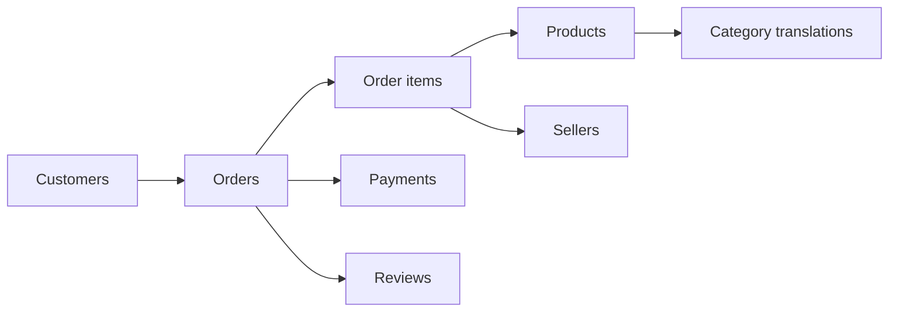

# E-commerce Analytics | SQL & Python Portfolio

**An end-to-end data analytics portfolio project using real historical e-commerce transactions.**

**Stack:** SQLite · SQL (CTEs, joins, aggregations, window functions) · Python · Matplotlib · Data quality checks

## Business problem

Imagine joining an e-commerce analytics team. Stakeholders want to understand sales performance, customer behavior and delivery quality using data rather than assumptions. This project answers ten business questions with **reproducible SQL queries** and turns the findings into tables and charts.

## Data source and attribution

[**Brazilian E-Commerce Public Dataset by Olist** (Kaggle)](https://www.kaggle.com/datasets/olistbr/brazilian-ecommerce), published by Olist and collaborators. The historical anonymized dataset contains approximately **100,000 orders placed between 2016 and 2018** across multiple Brazilian marketplaces. Olist distributes it under **CC BY-NC-SA 4.0**. The original CSV files are *not included here*; download them from the publisher and observe its license terms.

> **Project status:** The analysis pipeline and SQL queries are ready. Real business results must be generated by running the code on the original dataset. No figures in this README are presented as computed findings.

## Questions answered

| # | Business question | SQL |
|---|---|---|
| 01 | What are delivered-order sales, AOV and on-time delivery? | [Executive KPIs](sql/queries/01_executive_kpis.sql) |
| 02 | How does monthly sales performance change over time? | [Monthly sales](sql/queries/02_monthly_sales.sql) |
| 03 | Which product categories generate the most sales? | [Category performance](sql/queries/03_category_performance.sql) |
| 04 | How important are repeat customers? | [Repeat customers](sql/queries/04_repeat_customers.sql) |
| 05 | How does delivery reliability vary by state? | [Delivery performance](sql/queries/05_delivery_performance.sql) |
| 06 | How are different payment methods used? | [Payment methods](sql/queries/06_payment_methods.sql) |
| 07 | Which destination regions generate the most sales? | [Regional sales](sql/queries/07_regional_sales.sql) |
| 08 | Do late deliveries correlate with poor reviews? | [Reviews vs delivery](sql/queries/08_reviews_vs_delivery.sql) |
| 09 | Which sellers contribute the most item sales? | [Top sellers](sql/queries/09_top_sellers.sql) |
| 10 | How do repeat purchases and recency segment buyers? | [Customer recency](sql/queries/10_customer_recency.sql) |

## Data relationships



All metrics have explicit definitions in [docs/metrics.md](docs/metrics.md), and [docs/analysis_plan.md](docs/analysis_plan.md) sets out how to interpret results before making recommendations. In particular, **order-item prices must not be summed after joining directly to payment transactions**—that would overcount sales.

## Run locally

**Requirements:** Python 3.10+; no database server needed (SQLite is included with Python).

1. Clone/download this project, and download the Olist dataset at the source link above.
2. Unzip the original CSVs into `data/raw/`. The files should be directly inside that folder (not nested inside another folder). Eight CSVs are used; the geolocation CSV is not required.
3. From the project root, run:

```bash
python -m pip install -r requirements.txt
python src/build_database.py --data-dir data/raw --output data/olist.db
python src/check_quality.py --db data/olist.db
python src/run_analysis.py --db data/olist.db --output reports/generated
```

On Windows, replace `python` with `py` if needed.

**Outputs:**
- `data/olist.db`: normalized relational database (local and ignored by Git).
- `reports/generated/*.csv`: query results, including executive KPIs and customer segments.
- `reports/generated/charts/*.png`: monthly item sales, top categories and delivery performance.
- `reports/generated/SUMMARY.md`: a generated summary containing **actual computed figures**.

To run without Matplotlib: `python src/run_analysis.py --skip-charts`.

## Testing

```bash
python -m unittest discover -s tests -v
```

Tests run on an **explicitly synthetic miniature fixture** to validate query correctness, joins and the pipeline. **Synthetic test results are not real Olist business findings.**

## Repository layout

```text
├── data/raw/                # Put original Olist CSV files here (ignored by Git)
├── docs/metrics.md          # KPI definitions, assumptions, and limitations
├── docs/analysis_plan.md    # Stakeholder questions and findings template
├── sql/schema.sql           # Relational schema, keys and indexes
├── sql/queries/             # 10 analytical SQL queries
├── src/build_database.py    # Streaming CSV importer + FK integrity check
├── src/run_analysis.py      # CSV reports and reproducible charts
├── src/check_quality.py     # Data integrity and missing-value audit
├── tests/                   # Synthetic-data correctness tests
├── .github/workflows/       # Automated tests on pushes and pull requests
├── requirements.txt
└── README.md
```

## What this demonstrates

- Designing a relational schema and loading raw CSV data into **SQLite**.
- Writing business-oriented SQL with **CTEs, aggregates, window functions and safe joins**.
- Avoiding double counting by respecting the **grain** of orders, items and payments.
- Defining trustworthy KPIs, interpreting historical data and documenting limitations.
- Communicating results as reproducible reports and charts using Python.

## Next steps

After the full original dataset has been loaded and results inspected, add a short **Findings & Recommendations** section citing the actual computed numbers and figures. This should be written *after* running the analysis, never invented in advance.

---

**Portfolio project by Ismael Berja Ruiz** · Physics & Astrophysics · Python, SQL & scientific data analysis
