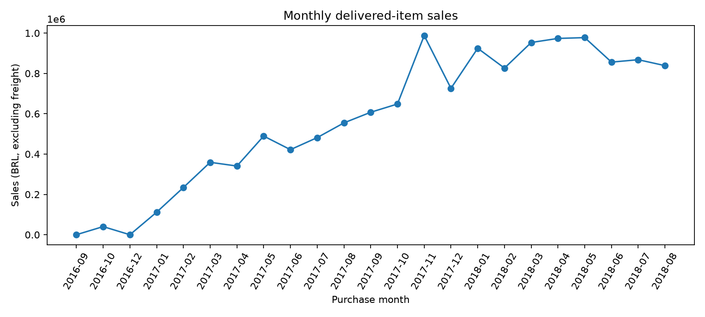
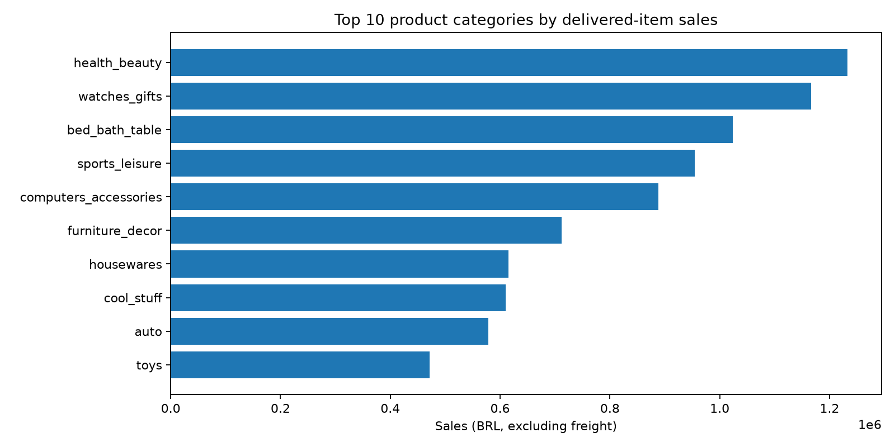
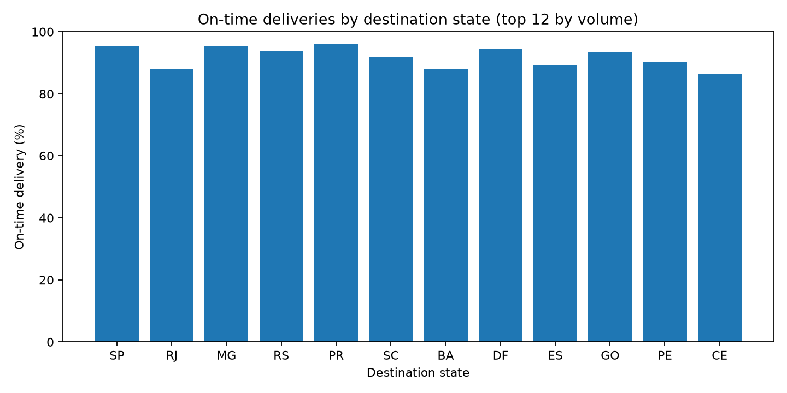

# Verified Olist Business Analytics — Results

These results were calculated from **original, historical Olist e-commerce transactions**, using this repository's ten SQL queries and Python reporting scripts. The pipeline was executed through [GitHub Actions](https://github.com/ismaelberja/olist-ecommerce-sql-portfolio/actions/runs/41481473572), with checks of the source files and database integrity.

## Executive scorecard

| KPI | Result |
|---|---:|
| Delivered orders | 96,478 |
| Unique buyers in delivered-order sample | 93,358 |
| Delivered item sales (excluding freight) | R$ 13,221,498.11 |
| Average order value | R$ 137.04 |
| Shipping charged to buyers | R$ 2,202,965.54 |
| On-time deliveries (non-missing actual and estimated delivery dates) | 93.23% |
| Repeat buyers (2+ delivered orders) | 2,801 |

## Key findings

- The largest categories by item sales are **health & beauty**, **watches & gifts**, and **bed, bath & table** (about 25.9% combined).
- Approximately **3.0% of buyers** in the delivered-order sample made two or more delivered orders within the observed period. This is not a lifetime retention metric.
- On-time delivery rates are **95.51% in São Paulo (SP)** and **87.89% in Rio de Janeiro (RJ)** for orders with the required dates. These figures are descriptive, not adjusted for logistics mix.
- Average review scores are **2.27 for late deliveries** and **4.29 for on-time deliveries**. The difference is an association and does not establish causality.

## Figures

## Detailed outputs

- [Executive KPI data](01_executive_kpis.csv)
- [Monthly sales](02_monthly_sales.csv)
- [Product categories](03_category_performance.csv)
- [Repeat customers](04_repeat_customers.csv)
- [Delivery performance by state](05_delivery_performance.csv)
- [Payment methods](06_payment_methods.csv)
- [Regional item sales](07_regional_sales.csv)
- [Reviews vs delivery](08_reviews_vs_delivery.csv)
- [Top sellers](09_top_sellers.csv)
- [Customer recency segments](10_customer_recency.csv)
- [Data quality audit](quality_checks.json)
- [Detailed metric definitions](../../docs/metrics.md)
- [Dataset provenance](DATA_SOURCE.md)

**Source:** Brazilian E-Commerce Public Dataset by Olist (2016–2018). The historical original files were downloaded from [Olist's official GitHub organization](https://github.com/olist/work-at-olist-data/tree/master/datasets). Original dataset and license: [Olist on Kaggle](https://www.kaggle.com/datasets/olistbr/brazilian-ecommerce), **CC BY-NC-SA 4.0**.

**Interpretation cautions:** The item-sales KPI is not accounting revenue or profit, only historical delivered order-item prices excluding freight. Boundary months may be incomplete. Causal conclusions cannot be drawn from these descriptive comparisons. Source CSVs and the SQLite database are not redistributed here.
